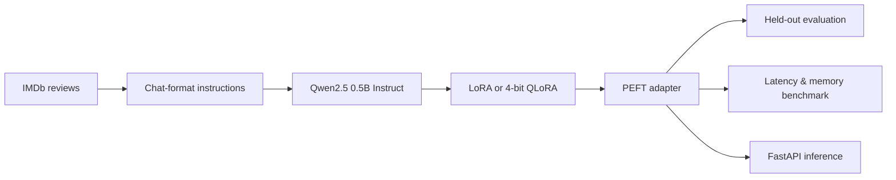

# NeuroForge AI

**Fine-tune · Compress · Optimize · Benchmark · Deploy**

A reproducible, open-source LLM engineering starter focused on **parameter-efficient language-model adaptation**, sentiment classification, efficient inference and measurable trade-offs.

> **Project status — implementation, not benchmark claims.** LoRA/QLoRA training code and evaluation tooling are provided. A complete GPU training run, quantitative quality metrics, memory savings, and acceleration have **not yet been verified**. Do not report improvements without reproducing the experiments.

## System design



## Features

- **Real LLM fine-tuning:** optimize LoRA adapter parameters on sentiment instructions, instead of merely calling a hosted LLM API.
- **Optional QLoRA:** NF4 4-bit base-model loading for CUDA-compatible training environments.
- **Knowledge distillation:** frozen larger Qwen teacher + smaller LoRA student, temperature-scaled token KL and answer-only supervised loss.
- **Offline integration tests:** tiny randomly initialized teacher/student, gradient-flow checks and adapter save/reload.
- **Evaluation:** held-out IMDb test set, accuracy, macro-F1 and invalid-answer rate.
- **Benchmark:** warm-up, empirical p50/p90/p95/p99 single-request latency, cold model-load time, sequential requests/sec, GPU allocated/reserved memory and process RSS.
- **Serving:** local FastAPI endpoint with lazy model loading and typed requests.
- **Engineering:** Python package, tests, linting, GitHub Actions and Docker support.

## Experimental GPU kernels

The kernel lab implements six opt-in Triton forward operators: RMSNorm, softmax,
SwiGLU, residual RMSNorm, split-half RoPE and tiled GEMM with shape-aware autotuning.
PyTorch reference implementations provide CPU and gradient-capable fallbacks.
The microbenchmarks record CUDA-event latency, numerical error and raw samples;
the advanced suite also provides analytical roofline estimates.

GPU compilation, numerical validation and performance measurements remain pending.
The operators do not automatically replace Qwen modules. The current target is
NVIDIA Ampere or newer on a compatible Linux/WSL2 PyTorch/Triton environment.

- [Basic kernels and validation](docs/GPU_KERNEL_PHASE1.md)
- [Advanced kernels and roofline methodology](docs/GPU_KERNEL_PHASE2.md)

```bash
pytest -q -rs tests/test_gpu_kernels.py tests/test_advanced_kernels.py tests/test_kernel_roofline.py
# With a compatible CUDA/Triton installation:
python -m neuroforge.kernel_benchmark --dtype float16
python -m neuroforge.advanced_benchmark --dtype float16
```

## Setup

Python 3.10+; a CUDA-capable GPU is recommended for training. Downloading the base model and IMDb dataset requires internet access.

```bash
python -m venv .venv
source .venv/bin/activate                  # Windows: .venv\Scripts\activate
pip install -e '.[dev]'
pytest -q
```

For CUDA-enabled QLoRA, install the optional dependency: `pip install -e '.[dev,qlora]'`.

## Train

```bash
# Genuine LoRA fine-tuning:
python -m neuroforge.train --output-dir outputs/qwen-lora --train-samples 2000 --eval-samples 300 --epochs 1

# 4-bit QLoRA (compatible NVIDIA CUDA):
python -m neuroforge.train --qlora --output-dir outputs/qwen-qlora --train-samples 2000 --eval-samples 300 --epochs 1
```

The training objective masks prompt tokens and optimizes only the assistant's target sentiment label. A stratified validation subset comes from the original IMDb training split. The IMDb test split is reserved for reporting.

## Teacher–student knowledge distillation

The larger teacher model is frozen; the smaller LoRA student is trained using temperature-scaled KL divergence on **answer token positions only**, blended with supervised cross-entropy. The script checks tokenizer vocabulary compatibility before training. Keep both model revisions and the same prompt protocol for fair comparisons. The CPU/GPU memory cost of *training with a teacher* is higher than serving the smaller student alone.

```bash
python -m neuroforge.distillation --teacher Qwen/Qwen2.5-1.5B-Instruct --student Qwen/Qwen2.5-0.5B-Instruct --output-dir outputs/distilled-student --train-samples 1000 --eval-samples 200
python -m neuroforge.evaluate --adapter outputs/distilled-student --output-json outputs/distilled_evaluation.json
```

The commands are not evidence of completed training. See [distillation protocol](docs/DISTILLATION.md).

## Evaluate and benchmark

```bash
python -m neuroforge.evaluate --test-samples 200 --output-json outputs/baseline_metrics.json
python -m neuroforge.evaluate --adapter outputs/qwen-lora --test-samples 200 --output-json outputs/lora_metrics.json
python -m neuroforge.benchmark --adapter outputs/qwen-lora --iterations 50 --warmup 10 --output-json outputs/lora_benchmark.json
# To compare 4-bit inference: add --load-in-4bit
```

These are *example commands*, not evidence of completed experiments. Record GPU, software versions, seed, dataset subset, batch size, model revision, adapter configuration, F1, latency and memory for each experiment. See [experimental protocol](docs/EXPERIMENTS.md) and [pre-results audit](docs/PRE_RELEASE_AUDIT.md).

## Local API

```bash
export NEUROFORGE_ADAPTER=outputs/qwen-lora
uvicorn neuroforge.api:app --host 127.0.0.1 --port 8000
curl -X POST http://127.0.0.1:8000/analyze -H 'Content-Type: application/json' -d '{"text":"An unexpectedly delightful movie."}'
```

For a valid prediction, the API returns e.g. `{"sentiment":"positive","raw_output":"positive"}`; unexpected free-form responses return HTTP 422, not a fabricated classification. `GET /health` checks whether an adapter path is configured, not whether weights are actually loadable.

## Repository roadmap

1. Verify LoRA and QLoRA GPU training end-to-end with pinned versions and reproducible runs.
2. Compare FP16/BF16 against supported 4-bit inference and measure the accuracy–latency–memory trade-off.
3. Run the implemented teacher–student **knowledge distillation** pipeline on a suitable GPU, evaluate the resulting student, and compare with direct LoRA training. No GPU validation or empirical improvement is claimed.
4. Add additional model families, model/export formats, dashboards and deployment hardening.

## Responsible publication

This is a newly authored implementation motivated by a prior DistilBERT / LLaMA API sentiment prototype. **The original notebook, its third-party pretrained artifacts, and its API credentials are not published here.** Do not commit API keys, model checkpoints, IMDb dataset copies, or private files. Models and datasets retain their respective upstream licences. The MIT licence applies only to the original code in this repository.
