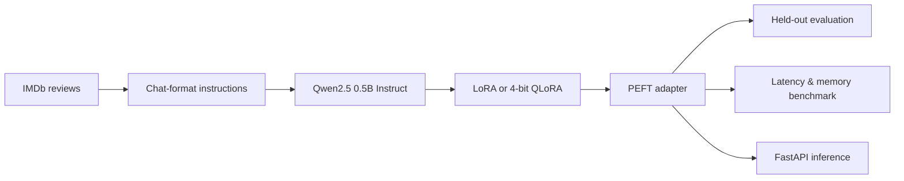

# NeuroForge AI

Maintained by Shahab Baloochi.

**Fine-tune · Compress · Optimize · Benchmark · Deploy**

An open-source engineering project for **LLM compression, GPU kernel development and numerical validation**, with parameter-efficient fine-tuning, knowledge distillation, evaluation and local serving.

> **Project status — implementation, not benchmark claims.** LoRA/QLoRA training code and evaluation tooling are provided. A complete GPU training run, quantitative quality metrics, memory savings, and acceleration have **not yet been verified**. Do not report improvements without reproducing the experiments.

## Project at a glance

- **GPU kernel lab:** Triton RMSNorm, softmax, SwiGLU, RoPE, tiled GEMM and packed INT4 weight-only GEMM.
- **Model compression:** row-wise, grouped and per-channel INT8; packed INT4; explicit FP32/FP16/BF16 operand policies.
- **Numerical engineering:** independent NumPy FP64 references, property-based and metamorphic tests, stress workloads, error attribution and storage/error trade-offs.
- **LLM pipeline:** LoRA/QLoRA, teacher–student distillation, evaluation, benchmarking and FastAPI serving.

### Verified CPU validation

[CI #189](https://github.com/shahab199271/NeuroForge-AI/actions/runs/46139659756) ·
[merged PR #12](https://github.com/shahab199271/NeuroForge-AI/pull/12) ·
[validation reports](https://github.com/shahab199271/NeuroForge-AI/actions/runs/46139659756/artifacts/15261422030)

| Evidence | Result |
| --- | ---: |
| Full pytest suite | 308 passed, 100 skipped, 0 failed |
| Hypothesis generated examples | 1,800 passed in the dedicated run |
| Repeated contract and stress tests | 41 passed |
| CPU-facing kernel coverage (lines + branches) | 86.16% |
| Whole kernel coverage (including GPU-only code) | 58.50% |
| Reproducibility | Two identical 144-row reports |
| SciPy/Matplotlib reporting | 48 matched configurations |
| Ruff, scoped strict Mypy, pip check | Passed |

The CI run used CPU execution; skipped tests include GPU paths. Coverage
does not establish GPU correctness or performance. The kernel lab is not
yet integrated into Qwen. No measured GPU speedup is claimed.

## System design



## Features

- **Real LLM fine-tuning:** optimize LoRA adapter parameters on sentiment instructions, instead of merely calling a hosted LLM API.
- **Optional QLoRA:** NF4 4-bit base-model loading for CUDA-compatible training environments.
- **Knowledge distillation:** frozen larger Qwen teacher + smaller LoRA student, temperature-scaled token KL and answer-only supervised loss.
- **Offline integration tests:** tiny randomly initialized teacher/student, gradient-flow checks and adapter save/reload.
- **Evaluation:** held-out IMDb test set, accuracy, macro-F1 and invalid-answer rate.
- **Benchmark:** warm-up, empirical p50/p90/p95/p99 single-request latency, cold model-load time, sequential requests/sec, GPU allocated/reserved memory and process RSS.
- **Serving:** local FastAPI endpoint with lazy model loading and typed requests.
- **Engineering:** Python package, tests, linting, GitHub Actions and Docker support.

## Technology stack and engineering tools

| Area | Tools and languages |
| --- | --- |
| Implementation | Python, Triton language, PyTorch |
| LLM adaptation | Hugging Face Transformers, PEFT, Accelerate, optional bitsandbytes |
| Numerical validation | NumPy FP64 references, PyTorch FP64 diagnostics, SciPy descriptive statistics, Matplotlib trade-off plots |
| Automated testing | pytest, Hypothesis property and metamorphic tests, pytest-cov / coverage.py, bounded stress tests |
| Quality and automation | Ruff, scoped Mypy checking, GitHub Actions, YAML, Bash |
| Serving and packaging | FastAPI, Pydantic, Uvicorn, setuptools, Docker |
| GPU target (runtime unverified) | NVIDIA CUDA, Triton JIT; Compute Sanitizer protocol |

**Executed in CI:** pytest, Hypothesis, NumPy, PyTorch CPU, pytest-cov / coverage.py, SciPy, Matplotlib, Ruff, scoped strict Mypy and pip check. GitHub Actions generated the linked reports. **GPU tools are not yet runtime-validated:** CUDA/Triton and NVIDIA Compute Sanitizer; Nsight profiling is planned. See [engineering validation](docs/KERNEL_ENGINEERING_VALIDATION.md) for reproducible commands and scope.

## Experimental GPU kernels

The kernel lab is an opt-in research implementation, separate from the Qwen
training and serving pipeline. PyTorch references support CPU execution;
Triton paths target NVIDIA Ampere or newer.

| Milestone | Implemented operators | Validation status |
| --- | --- | --- |
| 1 | RMSNorm, softmax, SwiGLU | CPU CI passed; GPU pending |
| 2 | Residual RMSNorm, split-half RoPE, tiled GEMM, roofline model | CPU CI passed; GPU pending |
| 3.1 | Row-wise symmetric INT8 quantization and reconstruction | CPU CI passed; GPU pending |
| 3.2 | Group-wise and per-channel INT8 | CPU CI passed; GPU pending |
| 3.3 | Packed signed INT4, odd-width padding, group scales | CPU CI passed; GPU pending |
| 3.4 | Fused packed INT4 weight-only GEMM, FP32 accumulation | CPU CI passed; GPU pending |
| 3.5 | Explicit FP32/FP16/BF16 operand policies, fixed FP32 accumulation | CPU CI passed; GPU pending |
| 3.6 | FP64 error decomposition and synthetic diagnostic sweep | CPU CI passed; GPU pending |

The fused kernel decodes and scales weight tiles inside GEMM rather than
materializing a full decoded weight matrix. It uses floating-point dot
arithmetic, not native INT4 dot arithmetic. Public input checks may synchronize
CUDA; noncontiguous inputs may require copies. The kernel lab does not yet
replace Qwen modules. No GPU speedup, measured VRAM saving or model-quality
improvement is claimed.

- [Basic kernels](docs/GPU_KERNEL_PHASE1.md)
- [Advanced kernels and roofline](docs/GPU_KERNEL_PHASE2.md)
- [Row-wise INT8](docs/GPU_KERNEL_PHASE3_INT8.md)
- [Grouped INT8](docs/GPU_KERNEL_PHASE3_GROUPED.md)
- [Packed INT4](docs/GPU_KERNEL_PHASE3_INT4.md)
- [Fused INT4 GEMM](docs/GPU_KERNEL_PHASE3_INT4_GEMM.md)
- [Mixed precision policies](docs/GPU_KERNEL_PHASE3_MIXED_PRECISION.md)
- [Quantization error analysis](docs/GPU_KERNEL_PHASE3_ERROR_ANALYSIS.md)
- [GPU environment and validation protocol](docs/GPU_VALIDATION.md)
- [Capability and evidence register](docs/GPU_KERNEL_STATUS.md)

```bash
pytest -q -rs tests/test_gpu_kernels.py tests/test_advanced_kernels.py tests/test_kernel_roofline.py tests/test_int8_quantization.py tests/test_group_quantization.py tests/test_int4.py tests/test_int4_gemm.py tests/test_mixed_precision.py tests/test_error_analysis.py
# On a compatible CUDA/Triton installation:
python -m neuroforge.kernel_benchmark --dtype float16
python -m neuroforge.advanced_benchmark --dtype float16
```

The existing benchmark commands cover phases 1–2. A dedicated quantized
benchmark suite is planned for phase 3.8. For installation of the proposed
GPU validation stack, follow the validation protocol rather than installing
an arbitrary standalone Triton version.

Run numerical diagnostics with `python -m neuroforge.quantization_error_sweep`.
Next: quantized autotuning (3.7) and advanced benchmarking (3.8).

## Setup

Python 3.10+; a CUDA-capable GPU is recommended for training. Downloading the base model and IMDb dataset requires internet access.

```bash
python -m venv .venv
source .venv/bin/activate                  # Windows: .venv\Scripts\activate
pip install -e '.[dev]'
pytest -q
```

For CUDA-enabled QLoRA, install the optional dependency: `pip install -e '.[dev,qlora]'`.

## Train

```bash
# Genuine LoRA fine-tuning:
python -m neuroforge.train --output-dir outputs/qwen-lora --train-samples 2000 --eval-samples 300 --epochs 1

# 4-bit QLoRA (compatible NVIDIA CUDA):
python -m neuroforge.train --qlora --output-dir outputs/qwen-qlora --train-samples 2000 --eval-samples 300 --epochs 1
```

The training objective masks prompt tokens and optimizes only the assistant's target sentiment label. A stratified validation subset comes from the original IMDb training split. The IMDb test split is reserved for reporting.

## Teacher–student knowledge distillation

The larger teacher model is frozen; the smaller LoRA student is trained using temperature-scaled KL divergence on **answer token positions only**, blended with supervised cross-entropy. The script checks tokenizer vocabulary compatibility before training. Keep both model revisions and the same prompt protocol for fair comparisons. The CPU/GPU memory cost of *training with a teacher* is higher than serving the smaller student alone.

```bash
python -m neuroforge.distillation --teacher Qwen/Qwen2.5-1.5B-Instruct --student Qwen/Qwen2.5-0.5B-Instruct --output-dir outputs/distilled-student --train-samples 1000 --eval-samples 200
python -m neuroforge.evaluate --adapter outputs/distilled-student --output-json outputs/distilled_evaluation.json
```

The commands are not evidence of completed training. See [distillation protocol](docs/DISTILLATION.md).

## Evaluate and benchmark

```bash
python -m neuroforge.evaluate --test-samples 200 --output-json outputs/baseline_metrics.json
python -m neuroforge.evaluate --adapter outputs/qwen-lora --test-samples 200 --output-json outputs/lora_metrics.json
python -m neuroforge.benchmark --adapter outputs/qwen-lora --iterations 50 --warmup 10 --output-json outputs/lora_benchmark.json
# To compare 4-bit inference: add --load-in-4bit
```

These are *example commands*, not evidence of completed experiments. Record GPU, software versions, seed, dataset subset, batch size, model revision, adapter configuration, F1, latency and memory for each experiment. See [experimental protocol](docs/EXPERIMENTS.md) and [pre-results audit](docs/PRE_RELEASE_AUDIT.md).

## Local API

```bash
export NEUROFORGE_ADAPTER=outputs/qwen-lora
uvicorn neuroforge.api:app --host 127.0.0.1 --port 8000
curl -X POST http://127.0.0.1:8000/analyze -H 'Content-Type: application/json' -d '{"text":"An unexpectedly delightful movie."}'
```

For a valid prediction, the API returns e.g. `{"sentiment":"positive","raw_output":"positive"}`; unexpected free-form responses return HTTP 422, not a fabricated classification. `GET /health` checks whether an adapter path is configured, not whether weights are actually loadable.

## Repository roadmap

1. Verify LoRA and QLoRA GPU training end-to-end with pinned versions and reproducible runs.
2. Compare FP16/BF16 against supported 4-bit inference and measure the accuracy–latency–memory trade-off.
3. Run the implemented teacher–student **knowledge distillation** pipeline on a suitable GPU, evaluate the resulting student, and compare with direct LoRA training. No GPU validation or empirical improvement is claimed.
4. Add additional model families, model/export formats, dashboards and deployment hardening.

## Responsible publication

This implementation is motivated by a prior DistilBERT / LLaMA API sentiment prototype. **The original notebook, its third-party pretrained artifacts, and its API credentials are not published here.** Do not commit API keys, model checkpoints, IMDb dataset copies, or private files. Models and datasets retain their respective upstream licences. The MIT licence applies only to the original code in this repository.
